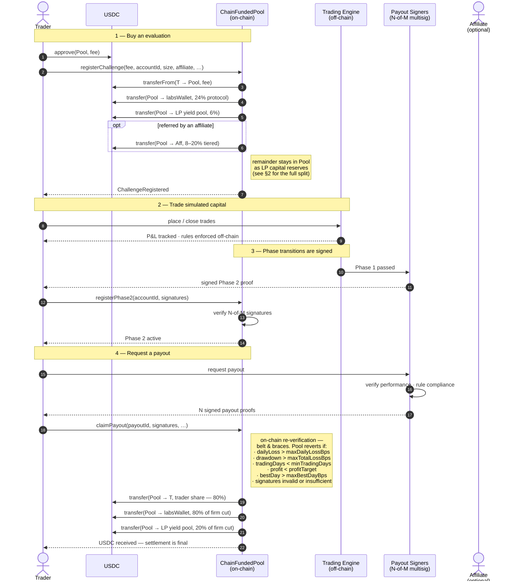
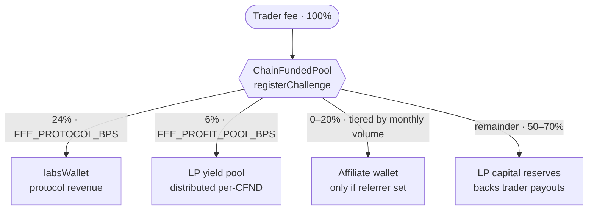
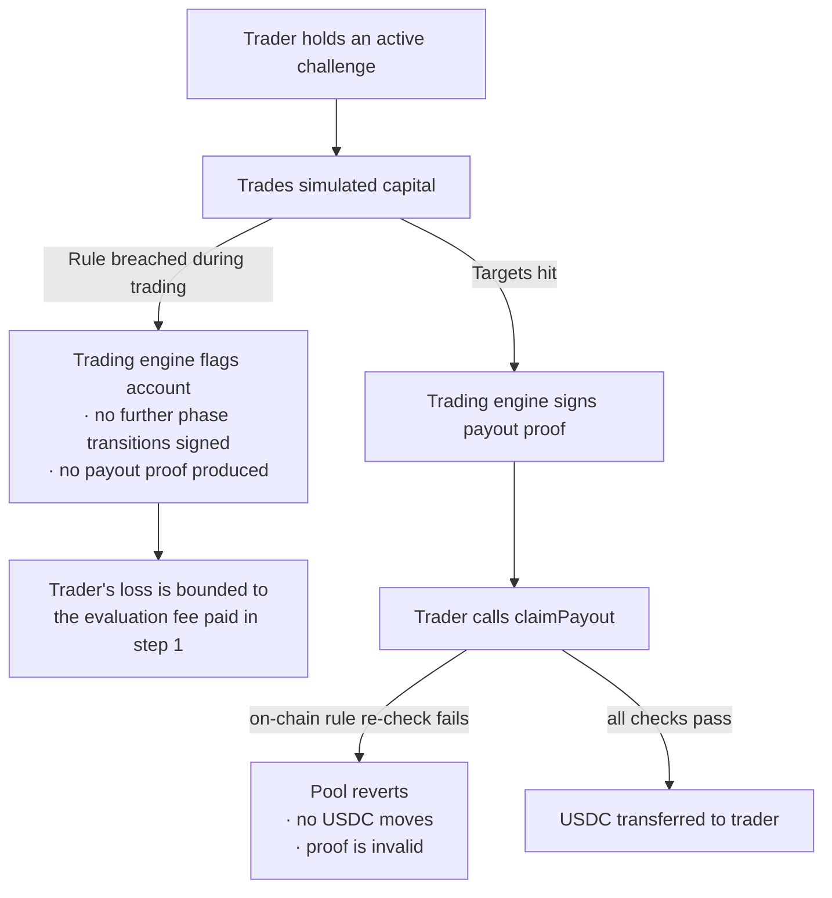
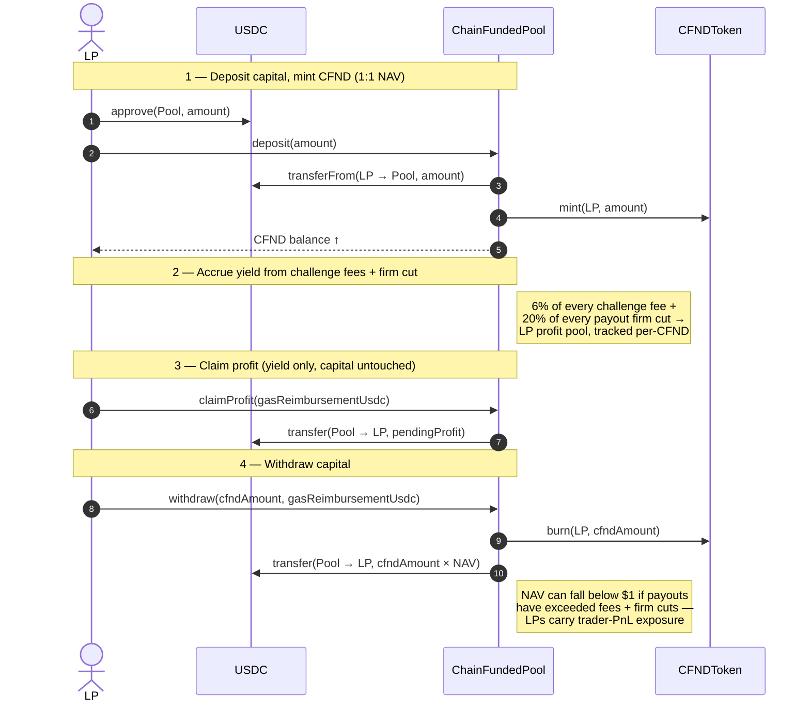

# User flow diagrams — ChainFunded whitepaper

Mermaid source for the user flow diagrams. GitHub renders Mermaid in
markdown automatically, so this file is the working draft — once we lock
the flows, the final whitepaper PDF will use Figma exports of the same
shapes, in brand colours.

> Edit / paste these into <https://mermaid.live> to preview standalone.

---

## 1. Trader — happy-path lifecycle

The main figure of the whitepaper. Shows the full path from "trader buys an
evaluation" to "trader receives USDC payout", with on-chain vs off-chain
participants clearly separated.

> **Phase 2 vs Funded.** Step 3 generalises both phase transitions —
> `registerPhase2` (Phase 1 → Phase 2) and `registerFunded` (Phase 2 →
> Funded) use the same signed-by-multisig shape. The whitepaper body
> covers both explicitly; the diagram shows one to keep the visual tight.

### Notes for the Figma redraw

- Render **on-chain participants** (USDC, Pool) on a darker background lane
  to visually separate from off-chain (Sim, Sig). This is the single most
  important visual distinction in the whitepaper — it's what the protocol's
  "can't choose not to pay you" pitch rests on.
- Group step 1 in a "Purchase" rect, 2 in "Trading", 3–4 in "Settlement".
  Same structure as the conversation in the document body.
- Highlight the lines that *move USDC* in primary (Evergreen) green. All
  other lines neutral grey. Reader's eye traces money flow immediately.
- The "on-chain re-verification" note at step 4 should be a **callout
  block** in the final art, not just a side-note. It's the single
  strongest narrative point the diagram makes — every revert listed is a
  guarantee the protocol can't break.
- Affiliate is dotted-bordered / dimmed when not present — visually
  signals the path is optional without taking up much room.

---

## 2. Challenge fee — split breakdown

Companion mini-diagram to step 1 above. Shows where every USDC of an
evaluation fee goes, by BPS, sourced directly from the on-chain constants
in `ChainFundedPool.sol`:

> Splits are fixed in contract storage: `FEE_PROTOCOL_BPS = 2400`,
> `FEE_PROFIT_POOL_BPS = 600`, `MAX_AFFILIATE_BPS = 2000`. The affiliate
> share is determined by the referring affiliate's rolling-month volume —
> non-referred fees route everything else to LP capital.

---

## 3. Failure paths

Implicit in the happy-path diagram, called out here for the whitepaper
body. Two distinct failure modes:

> **Belt and braces.** Off-chain rule enforcement is the *belt* — the
> signers refuse to sign a payout proof for a breached account. On-chain
> rule re-verification at `claimPayout` is the *braces* — even if the
> signers collude to sign a false proof, the pool reverts. Both must
> agree before USDC leaves the pool.

---

## 4. Liquidity Provider — capital lifecycle

Secondary figure. LP-side mechanics are simpler than the trader side, so
this stays compact.

---

## 5. Decisions

Resolutions to the open questions raised on the first draft of this file.
Kept as a record so the Figma re-draw and the whitepaper body track the
same decisions:

- **Affiliates** — folded into the fee-split annotation in §1, with a
  dedicated mini-flowchart in §2 showing the full split tree. Affiliate
  appears in §1 as an optional actor (dimmed when not present).
- **Contract-enforced rules** — surfaced as an explicit callout at §1
  step 4, listing every revert the pool can throw during `claimPayout`.
  This is the protocol's strongest selling point and gets a dedicated
  callout block in the Figma redraw.
- **Phase 2 vs Funded** — single shape on the main diagram, with a
  footnote that `registerFunded` follows the identical pattern.
  Avoids bloating the figure for a transition that's mechanically the
  same.
- **Failure paths** — given their own flowchart in §3 rather than
  branching the sequence diagram. Sequence diagrams get noisy when they
  fork; a small flowchart reads cleaner and lets us tell the
  "belt + braces" story in one place.
